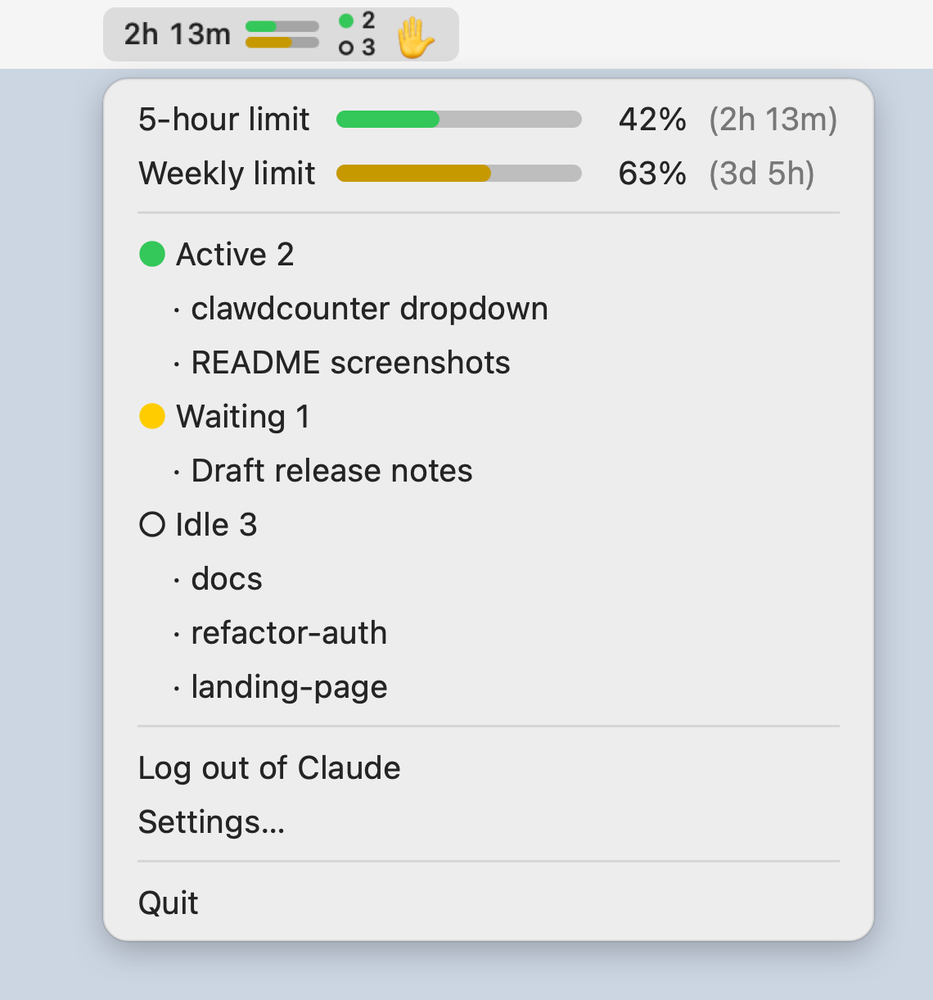

# ClawdCounter

[한국어](README.md) | [English](README.en.md) | [简体中文](README.zh-CN.md) | [日本語](README.ja.md)

An unofficial macOS menu bar app that shows your Claude usage limits (5-hour / weekly) and the state of your local Claude Code sessions at a glance. Not affiliated with Anthropic; it relies on undocumented endpoints that may change or be blocked at any time. The UI supports Korean, English, Simplified Chinese, and Japanese.

<p align="center">
  <picture>
    <source media="(prefers-color-scheme: dark)" srcset="docs/images/readme-menu-en-dark.png">
    
  </picture>
</p>
<p align="center"><sub>Rendered with sample data.</sub></p>

## Features

- **Menu bar display**: `5-hour time remaining | [5-hour bar / Weekly bar] | ● Active count / ○ Idle count | ✋ Waiting`
  - When the 5-hour window is not active, `–` is shown in place of the time remaining. If there is no 5-hour limit at all, only the weekly bar is shown.
  - `✋` appears only when a session is waiting, and the count is shown as well when there are two or more.
  - When logged out, it shows `Login required`; when the login has expired, it shows `Log in again`.
- **Four-level usage colors**: The colors of the bars and the dropdown are based on the whole-number percentage shown on screen (rounded).

  | Usage | Color |
  |---|---|
  | 0–49% | Green |
  | 50–79% | Yellow |
  | 80–94% | Orange |
  | 95% or more | Red |

- **Dropdown** (sections separated by dividers)
  1. Limits: 5-hour / Weekly / Fable. Bar, percentage, and time remaining. If a limit is missing from the API response, that row is not shown.
  2. Credits: the extra usage (credits) amount. If the total is known, shown as `used / total`.
  3. Sessions: a header per state and a list of session names (up to 8 per state; the rest are shown as `+N more`).
  4. Log in to Claude / Log out of Claude, Settings (Launch at login, Usage refresh interval of 1, 2, or 5 minutes, Language).
  5. Quit.
- **Three session states**: ● Active (green) / Waiting (✋ in the menu bar, a yellow ● in the dropdown) / ○ Idle. Each running subagent is added to the active count of its session and listed as `↳ description`.
- **Click a session name**: brings the app running that session (a terminal, VS Code, the Claude desktop app, etc.) to the front.
- **Multilingual**: Supports four languages: 한국어, English, 简体中文, and 日本語. It follows the system language by default, and you can change the language in Settings.

## Notice / Disclaimer

- This is an **unofficial app, not affiliated with Anthropic**. It is not made or endorsed by Anthropic.
- The usage API (`api.anthropic.com/api/oauth/usage`) and the OAuth client ID are **unofficial values** found in an installed copy of Claude Code. They are not a documented public API, so they **may change or be blocked at any time**, and the app may stop working if that happens.
- There is no warranty, and the author takes no responsibility for any account-related problems that arise from using this app (see LICENSE).

## Requirements

- macOS 14 or later
- Release app: Apple Silicon Mac (on an Intel Mac, build from source)
- Building from source: Xcode and the Swift 6 toolchain (`swift-tools-version: 6.0`)

## Installation / Build

### Download a release

1. Download `ClawdCounter-<version>.dmg` from [Releases](https://github.com/wooklab/clawdcounter/releases/latest) and open it.
2. Drag `ClawdCounter.app` into the `Applications` folder.

### Build from source

```sh
git clone https://github.com/wooklab/clawdcounter.git
cd clawdcounter
scripts/build_app.sh        # Output: build/ClawdCounter.app
open build/ClawdCounter.app
```

The app is menu bar only (`LSUIElement`), so it has no Dock icon.

### First-launch warning

Both the release app and the build script use only an ad-hoc signature (`codesign --sign -`), and the app is not notarized by Apple. An app you built yourself usually launches without a warning, but Gatekeeper blocks a downloaded release app on first launch. In that case, use one of the following:

- Close the warning, then open **System Settings → Privacy & Security** and click **Open Anyway** next to ClawdCounter.
- Or run `xattr -dr com.apple.quarantine /Applications/ClawdCounter.app`

Use the `xattr` command **only on a release from this repository or an app you built yourself**. Never use it on an app of unknown origin.

### Keychain prompt

When you log in, the app stores the tokens (access/refresh) in its own Keychain item, `ClawdCounter-credentials`. If you rebuild or update the app, the ad-hoc signature changes and the Keychain access prompt may appear again. Choose **Always Allow** when it does.

## Usage

1. When you launch the app, the menu bar shows `Login required`.
2. Click the menu bar item and choose **Log in to Claude**. Your default browser opens, and once you finish logging in, the app loads your usage automatically.
3. If the local callback server cannot be opened, the app switches to a flow where you paste the code shown in the browser into the app.
4. Usage is refreshed every minute by default (1, 2, or 5 minutes in Settings), and also whenever you open the menu.
5. You can change the display language under Settings → Language. The change applies immediately to the menu bar, the dropdown, and the settings window.

## Privacy

**Local files read** (all read-only)

- `~/.claude/sessions/*.json`: session state (`status`), name, working directory, session ID, and so on
- `~/.claude/projects/*/<sessionId>/subagents/*.meta.json`: subagent descriptions and whether they have finished
- For the subagent `jsonl` files in the same location, the app checks **only the modification time** and does not read their contents.

**Network**

- Login: `claude.com` (opens the authentication page in the browser), `platform.claude.com` (token issuance/refresh/revocation)
- Usage lookup: `api.anthropic.com`
- Nothing is sent to third-party servers, and there is no analytics or telemetry.

**Credentials**

- The app does not read or write Claude Code's credentials (its Keychain item, or the authentication data in `~/.claude`). It uses only the tokens it obtained through its own OAuth login.
- **Logging out** deletes the app's tokens from the Keychain and attempts to revoke them on the server (the local deletion stands even if revocation fails).

**What the app writes to disk**

- `~/Library/Application Support/ClawdCounter/last_usage_raw.json`: for debugging, this file is overwritten with the **raw text of the last usage API response** (permissions 0600). It contains your personal usage data, so do not share it. Tokens and headers are not saved.
- The usage refresh interval and language settings (UserDefaults).

## Known limitations

- **Verified with only one Max 5x account.** Other plans (Pro, Team, Enterprise, API, etc.) have not been verified.
- The response format when the Fable limit and credits (extra usage) are **enabled could not be confirmed, so it is implemented on assumptions**. Both were disabled in the responses actually observed.
- The count of session reset passes (tickets) is **not supported**, because no such field was found in the actual responses.
- The **Waiting** state is based on a value (`waiting`) found by analyzing the `claude` binary, and it has not been confirmed in a real session.
- Clicking a session name only brings **the app** to the front; it does not select a specific tab, window, or session within the app. If the parent process chain is broken, as with tmux, the app cannot be found.
- Release apps are only ad-hoc signed, are not notarized by Apple, and run on Apple Silicon only.

## Development

```sh
swift test                  # Run all unit tests
swift run RenderPreview     # Render menu bar image/dropdown PNGs -> build/preview/
```

`RenderPreview` must be run from the project root. It writes light and dark PNGs and a text file of the menu structure (`menus.txt`) to `build/preview/`, and also regenerates the per-language README screenshots (`docs/images/readme-menu-*.png`).

### `--probe-usage` diagnostic flag

```sh
build/ClawdCounter.app/Contents/MacOS/ClawdCounter --probe-usage
```

While logged in, this saves the responses to query variants of the usage API into `~/Library/Application Support/ClawdCounter/probe/`. The variant queries are unofficial values seen in the Claude Code binary, and their meaning has not been confirmed. **The saved responses contain your personal usage data, so be sure to redact them before posting them in an issue.**

For the structure of the project, see [docs/ARCHITECTURE.md](docs/ARCHITECTURE.md) (Korean).

## Contributing

Issues and PRs are welcome. In particular, **redacted usage API response samples from accounts on other plans** would be a big help. Please redact the values (percentages, amounts, dates, identifiers) and keep only the key structure.

## License

[MIT License](LICENSE)
